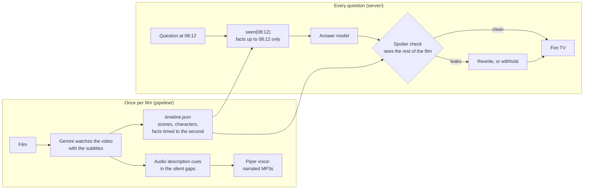

# Aside

**A friend on the couch who has seen exactly what you have, and never spoils what comes next.**

Aside is a Fire TV app for watching films with an AI that knows the story up to the second you're at. Press **Up** on the remote and ask what just happened, who that is, or what you missed while you were out of the room. Or scan a QR code and ask anything out loud from your phone. It also narrates audio description in the gaps between dialogue, for viewers who can't see the screen.

Entry for **Build, Ship, Shape: Amazon Developer Hackathon**, Fire TV track. Priority categories: AI-enhanced viewing, multi-modal UX, accessibility.


## What it does

Press **Up** (or **Menu ☰**) at any moment of a film. The film pauses and Aside offers:

| Button | What you get |
|---|---|
| **What just happened?** | The last minute or so, in two or three spoken sentences. |
| **Who's that?** | Who's on screen and what we know about them *so far*. A name only appears once the film has said it. |
| **Describe the scene** | The place, who's there and what they're doing, for someone who can't see the screen. |
| **What did I miss?** | Stepped out for two minutes? You get exactly those two minutes, nothing earlier. |
| **Story so far** | For coming back the next day. Aside offers it on its own when you resume after a long pause. |
| **Ask by phone** | A QR code. Scan it, tap the mic, ask anything ("Why does she want the dragon so badly?"). The answer appears on the TV and on the phone. |

Every answer has **Rewatch 03:12** buttons that jump back to the moment it's based on, and it's read aloud by the TV's own speech engine.

**Audio description**, switched on from the home screen, narrates what's on screen whenever nobody is speaking: *"In a vast snowy expanse, Sintel trudges forward with a walking staff, leaving footprints behind."* Narration is never placed over dialogue, and the film's volume dips while it plays.

## The promise: no spoilers

A companion that knows the whole film is easy to build and useless: ask it "is that dragon who I think it is?" and it tells you. Aside keeps three safeguards:

1. **It only reads what you've seen.** Gemini watches each film once and writes a timeline in which every fact carries the second it appears on screen. For each question the server passes only the facts up to your position. Names that the film hasn't said yet are swapped for descriptions ("the old shaman").
2. **A second model checks every answer against the rest of the film.** Hiding the future from the prompt isn't enough. The model may have read about the film, and models love to foreshadow ("keep an eye on that dragon…"). So a separate check, which does see what happens later, reads each answer. If the answer reveals, rules out or teases anything to come, it's rewritten. If the rewrite still leaks, it's withheld ("That's still ahead of us, so no spoilers from me").
3. **Aside's knowledge ends at the furthest point you've actually watched.** Rewinding to rewatch something doesn't move it forward. Skipping ahead is your choice and moves it with you.

`eval/spoilers.py` measures this: questions written to pry the future out ("Does she ever find him?", "How does it end?") and questions about what has been seen, each answered three ways (whole film in the prompt, only what you've seen, only what you've seen plus the check), graded by a separate judge model that sees the whole film. Results: [eval/RESULTS.md](eval/RESULTS.md).

## Why it matters

- **Shared TVs.** Somebody always steps out: the kitchen, the kids, a phone call. Today they pause everyone, rewind, ask the person next to them (who then misses the next bit), or search online and get spoiled. "What did I miss?" gives them exactly the span they missed.
- **Accessibility.** Audio description is written by hand, so most titles don't have it. Aside writes a description track from the video itself and places it only where nobody is speaking.
- **Where it fits at Amazon.** Prime Video's [X-Ray Recaps](https://techcrunch.com/2024/11/04/amazon-brings-generative-ai-powered-recaps-to-prime-video) already summarises a season or episode up to your minute, for Amazon MGM originals. Aside adds a two-way conversation (ask anything, by voice, from your phone), "what did I miss" for a span, generated audio description, and a spoiler check whose effect is measured. It also works on any film you can feed it, so any app on Fire TV could offer it, not only Prime Video. This build runs it end to end on two openly licensed films.

## How it works



- **`pipeline/`**: `analyze.py` (Gemini video understanding to a timeline; scene edges snapped to real shot cuts from ffmpeg), `describe.py` (audio description, word-budgeted to each silent gap at 2.5 words a second), `publish.py` (the files the TV may download, with narration rendered offline by [Piper](https://github.com/OHF-Voice/piper1-gpl) using the public-domain LJSpeech voice), `prepare.py` (the one-button answers, made ahead of time on a grid and spoiler-checked like live ones).
- **`server/`**: FastAPI. `knowledge.py` builds "what you've seen" and "what you haven't". `companion.py` answers and checks, trying Groq, then Gemini Flash, then Gemma, because free tiers are small and often busy. `app.py` holds the API, phone pairing and static files. The full timeline never leaves the server: the TV only gets titles, captions and audio description.
- **`web/tv/`**: the 10-foot UI, plain JavaScript (ES2017, no build step) so it runs on older Fire OS WebViews. It's laid out on a fixed 1920×1080 stage scaled to the screen, with geometric D-pad focus.
- **`web/phone/`**: the phone remote, using the phone's own speech recognition, so the TV needs no microphone.
- **`tv-app/`**: the Fire OS app (Kotlin): a full-screen WebView with a leanback launcher entry and a 320×180 banner. It passes the remote's Back, Menu, Play/Pause, Rewind and Fast-forward keys to the page (a plain web app can't receive Menu on Fire TV), keeps the screen on, and speaks answers with Android's TextToSpeech. It reads the server address from `tv-app/endpoint.txt` in this repo, so the server can move without a new APK.

## Fire TV specifics

| Remote | In a film | In a panel |
|---|---|---|
| D-pad | Left/Right: skip 10 s · Up: open Aside · Down: show progress | Move focus |
| Select | Play/pause | Choose |
| Menu ☰ | Open Aside | Close |
| Play/Pause, Rewind, Fast-forward | Play/pause, skip 30 s | Back to the film |
| Back | Back to the home screen | Close the panel |

The app was built against Amazon's Fire OS guidance, found through the [Amazon Devices Builder Tools](https://developer.amazon.com/docs/vega/0.24/mcp-server.html) MCP server: the remote key codes, `LEANBACK_LAUNCHER` plus a banner so it shows on the home screen, and the two WebView settings (`useWideViewPort`, `loadWithOverviewMode`) that Fire OS needs for a page's viewport.

## Run it

**Server** (Python 3.12):
```bash
pip install -r requirements.txt
export GEMINI_API_KEY=...        # free key from aistudio.google.com
export GROQ_API_KEY=...          # optional, free key from console.groq.com
uvicorn app:app --app-dir server --port 8000
# open http://localhost:8000/tv/ in a browser: arrow keys, Enter, Esc, M for Menu
```

**Deploy** on Render's free plan with the included `render.yaml` (New → Blueprint). Step-by-step instructions, plus installing on a Fire TV Stick with the Downloader app, are in [docs/SETUP.md](docs/SETUP.md).

**Fire TV app:**
```bash
cd tv-app && ./gradlew assembleRelease     # app/build/outputs/apk/release/app-release.apk
```
A built APK is in `dist/aside.apk` and is served by the server at `/apk`.

**Add a film:** put the video and an `.srt` in a folder, then run `pipeline/analyze.py`, `describe.py`, `publish.py` and `prepare.py` (each file's docstring has the command). It needs ffmpeg and a Gemini key.

## Built during the hackathon

Everything here is new and was written in October 2026 for this hackathon: the pipeline, server, TV app, phone remote, Fire OS wrapper and evaluation. The first commit is in this repo's history.

Built with Claude Code (an AI coding assistant), directed and reviewed by Jannet Ekka.

## Credits and licences

- Code: MIT, see [LICENSE](LICENSE).
- **Sintel** © Blender Foundation | [durian.blender.org](https://durian.blender.org), and **Tears of Steel** © Blender Foundation | [mango.blender.org](https://mango.blender.org), both [CC BY 3.0](https://creativecommons.org/licenses/by/3.0/). The copies in `media/` are re-encoded for streaming. The timelines and audio description in `data/films/` are derived from them and shared under the same licence.
- Narration voice: Piper with the LJSpeech voice (dataset in the public domain).
- AI: Google Gemini (video understanding, answers), Groq-hosted open models and Gemma (answers and checks).
