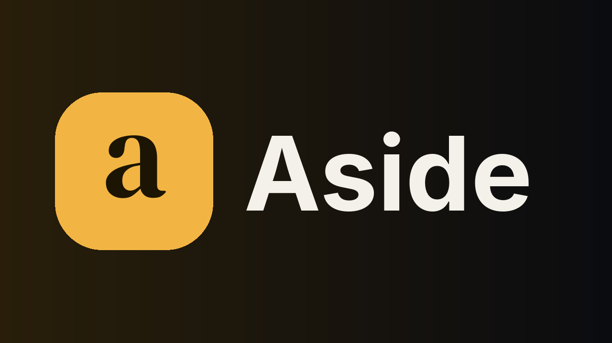
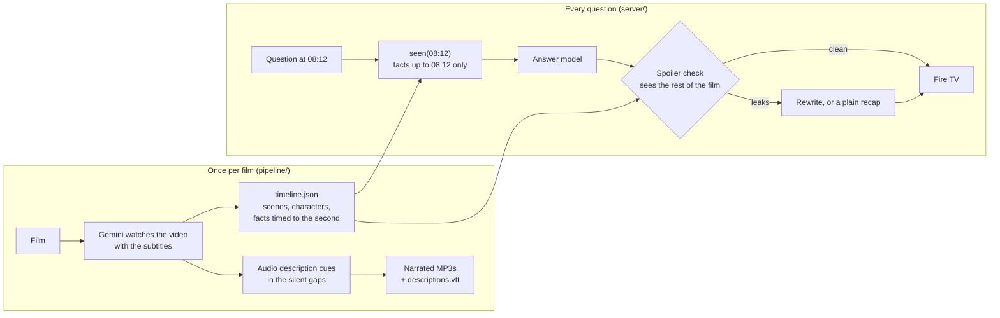

# Aside

**A friend on the couch who has seen exactly what you have, and never spoils what comes next.**

Aside is a Fire TV app for watching films with an AI that knows the story up to the second you're at. Press **Up** on the remote and ask what just happened, who that is, or what you missed while you were out of the room. Or scan a QR code and ask anything out loud from your phone. It also narrates audio description in the gaps between dialogue, for viewers who can't see the screen.

It runs on a real **Fire TV Stick 4K Select (Vega OS)**, built from Amazon's Vega WebView template, and on Fire OS sticks through an Android wrapper.

Entry for **Build, Ship, Shape: Amazon Developer Hackathon**, Fire TV track. Priority categories: AI-enhanced viewing, multi-modal UX, accessibility.



## What it does

Press **Up** at any moment of a film. The film pauses and Aside offers:

| Button | What you get |
|---|---|
| **What just happened?** | The last minute or so, in two or three spoken sentences. |
| **Who's that?** | Who's on screen and what we know about them *so far*. A name only appears once the film has said it. |
| **Describe the scene** | The place, who's there and what they're doing, for someone who can't see the screen. |
| **What did I miss?** | Stepped out for two minutes? You get exactly those two minutes, nothing earlier. |
| **Story so far** | For coming back the next day. Aside offers it on its own when you resume after a long pause. |
| **Ask by phone** | A QR code. Scan it, tap the mic, ask anything ("Why does she want the dragon so badly?"). The answer appears on the TV and on the phone. |

Every answer is read aloud and comes with **Rewatch 03:12** buttons that jump back to the moment it's based on.

**Audio description**, switched on from the home screen, narrates what's on screen whenever nobody is speaking: *"In a vast snowy expanse, Sintel trudges forward with a walking staff, leaving footprints behind."* Narration is never placed over dialogue, and the film dips gently while it plays. The tracks are also exported as standard WebVTT (`descriptions.vtt`), so any player can use them.

## The promise: no spoilers

A companion that knows the whole film is easy to build and useless: ask it "is that dragon who I think it is?" and it tells you. Aside keeps three safeguards:

1. **It only reads what you've seen.** Gemini watches each film once and writes a timeline in which every fact carries the second it appears on screen. For each question the server passes only the facts up to your position. Names the film hasn't said yet are swapped for descriptions ("the old shaman"), and the model is told never to assert or deny anything the film hasn't shown.
2. **A second model checks every answer against the rest of the film.** Hiding the future from the prompt isn't enough. The model may have read about the film, and models love to foreshadow. So a separate check, which sees both what you've seen and what happens later, reads each answer. If the answer reveals, rules out or teases anything to come, it's rewritten. If a button answer still leaks, Aside answers with a plain recap stitched from the timeline's own facts up to now; a free question gets "That's still ahead of us, so no spoilers from me".
3. **Aside's knowledge ends at the furthest point you've actually watched.** Rewinding to rewatch something doesn't move it forward.

### Measured

`eval/spoilers.py` asks 24 questions over both films, 16 of them written to pry the future out ("Does she ever find Scales?", "How does it end?"). Each is answered three ways through the deployed server and graded by a separate judge model that sees the whole film ([full results](eval/RESULTS.md)):

| Setup | Spoiled a future-probing question | Helpful on questions about what you've seen |
|---|---|---|
| Whole film in the prompt, told not to spoil | 6 of 16 | 7 of 8 |
| Only what you've seen | 1 of 16 | 8 of 8 |
| **Aside: only what you've seen + spoiler check** | **0 of 16** | **8 of 8** |

Telling the model not to spoil isn't enough (6 of 16). Most of the gain comes from never giving it the future. In this run the check didn't need to rewrite anything, so the gap between the last two rows is within run-to-run variation. On the live server the check did catch real leaks: asked at 09:00 whether the cave dragon is Scales, an answer model said "No, it's a different dragon" (false, and it rules out the twist). The check stopped it, and the prompt rule against asserting identities came from that case.

## Why it matters

- **Shared TVs.** Somebody always steps out: the kitchen, the kids, a phone call. Today they pause everyone, rewind, ask the person next to them (who then misses the next bit), or search online and get spoiled. "What did I miss?" gives them exactly the span they missed.
- **Accessibility.** Audio description is written by hand, so most titles don't have it. Aside writes a description track from the video itself and places it only where nobody is speaking.
- **Where it fits at Amazon.** Prime Video's [X-Ray Recaps](https://techcrunch.com/2024/11/04/amazon-brings-generative-ai-powered-recaps-to-prime-video) already summarises a season or episode up to your minute, for Amazon MGM originals. Aside adds a two-way conversation (ask anything, by voice, from your phone), "what did I miss" for a span, generated audio description, and a measured spoiler check. It works on any film it's given, so any app on Fire TV could offer it, not only Prime Video. This build runs it end to end on two openly licensed films.

## How it works



- **`pipeline/`**: `analyze.py` (Gemini video understanding to a timeline; scene edges snapped to real shot cuts found with ffmpeg), `describe.py` (audio description, word-budgeted to each silent gap at 2.5 words a second), `publish.py` (the files the TV may download: captions, description cues, narration levelled to -16 LUFS and fitted to each gap, WebVTT tracks), `prepare.py` (the one-button answers made ahead of time every 30 seconds and spoiler-checked like live ones, so buttons stay instant when the free AI tiers are busy).
- **`server/`**: FastAPI on Render's free plan. `knowledge.py` builds "what you've seen" and "what you haven't". `companion.py` answers and checks, falling back across Groq (gpt-oss-120b, Qwen 3.8, gpt-oss-20b), Gemini Flash and Gemma, because each free tier is small and often busy. `app.py` holds the API, phone pairing, the read-aloud voice and the static files. The full timeline never leaves the server: the TV only gets titles, captions and audio description.
- **`web/tv/`**: the 10-foot UI, plain JavaScript (ES2017, no build step), laid out on a fixed 1920×1080 stage scaled to the screen, with geometric D-pad focus.
- **`web/phone/`**: the phone remote, using the phone's own speech recognition, so the TV needs no microphone.
- **`vega-app/`**: the **Vega OS** app (React Native for Vega, from Amazon's `vegaWebview` template). A full-screen Vega WebView loads the TV app; `allowSystemKeyEvents` delivers Back to the page as `GoBack`, the page posts `EXIT_APP` at its home screen, media keys reach the page directly, and a native "Try again" screen covers a sleeping server. Vega's WebView has no speech API, so answers are read aloud by the server (Groq's Orpheus voice).
- **`tv-app/`**: the **Fire OS** app (Kotlin): a full-screen WebView with a leanback launcher entry and banner, the remote's Back, Menu and media keys forwarded to the page, Android TextToSpeech, and the WebView settings Amazon's Fire OS guide requires (found through Amazon Devices Builder Tools).

## Run it

**Try the TV app in a browser:** https://aside-tv.onrender.com/tv/ (free hosting: the first load can take a minute). Arrow keys, Enter, Esc for Back; **Up** during a film opens the questions.

**On a Vega OS Fire TV Stick** (Fire TV Stick 4K Select and newer): enable Developer Mode, switch Connection Mode to TCP/IP, then from any computer with `adb`:
```
adb connect <stick-ip>:5555
adb push aside.vpkg /tmp/aside.vpkg            # from https://aside-tv.onrender.com/vpkg
adb shell vpm install /tmp/aside.vpkg
adb shell vlcm launch-app orpheus://com.jannetekka.aside.main
```
Step by step, including Developer Mode from a Windows laptop: [docs/VEGA.md](docs/VEGA.md). To build the package yourself: `cd vega-app && npm install && npm run build:release` (Vega SDK 0.24).

**On a Fire OS stick:** install `https://aside-tv.onrender.com/apk` with the Downloader app or `adb install`; see [docs/SETUP.md](docs/SETUP.md). Build with `cd tv-app && ./gradlew assembleRelease`.

**Server** (Python 3.12):
```bash
pip install -r requirements.txt
export GEMINI_API_KEY=...        # free key from aistudio.google.com
export GROQ_API_KEY=...          # free key from console.groq.com
uvicorn app:app --app-dir server --port 8000      # then open http://localhost:8000/tv/
```
Or deploy on Render's free plan with the included `render.yaml` (New → Blueprint).

**Add a film:** put the video and an `.srt` in a folder and run `pipeline/analyze.py`, `describe.py`, `publish.py` and `prepare.py` (each file's docstring has the command). Tests: `python -m pytest tests`.

## Built during the hackathon

Aside is new. Everything here was written in October 2026 for this hackathon: the pipeline, server, TV app, phone remote, the Vega and Fire OS apps, and the evaluation. The first commit is in this repo's history. Notes on the developer tools, including a friction log, are in [docs/SUBMISSION.md](docs/SUBMISSION.md).

Built with Claude Code (an AI coding assistant), directed and reviewed by Jannet Ekka.

## Credits and licences

- Code: MIT, see [LICENSE](LICENSE).
- **Sintel** © Blender Foundation | [durian.blender.org](https://durian.blender.org), and **Tears of Steel** © Blender Foundation | [mango.blender.org](https://mango.blender.org), both [CC BY 3.0](https://creativecommons.org/licenses/by/3.0/). The copies in `media/` are re-encoded for streaming. The timelines and audio description in `data/films/` are derived from them and shared under the same licence. They are not covered by the MIT licence.
- Voices: answers and audio description are spoken by Groq's Orpheus model ("Diana"). `publish.py --piper` renders narration offline with Piper's LJSpeech voice (public-domain recordings) instead.
- AI: Google Gemini (video understanding, answers), Groq-hosted open models and Gemma (answers and checks), Groq Orpheus (speech).
